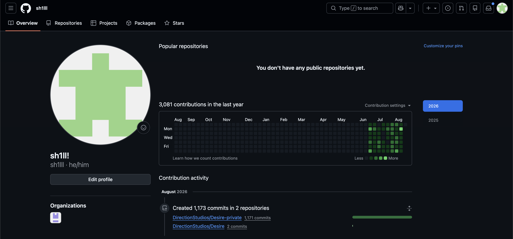

<!-- ╔══════════════════════════════════════════════════════════════════════╗ -->
<!-- ║  DESIRE : README. Banner: .github/assets/banner.svg                   ║ -->
<!-- ╚══════════════════════════════════════════════════════════════════════╝ -->

 

<!-- ── Live stats (auto-update once the repo is public + has releases) ── -->

 

<!-- ── Platform + stack ── -->

&nbsp;

  

### A private, offline-first AI operating layer for your computer.

**One program that can see your screen, run your machine, remember everything you've done, and build the tools it doesn't have yet.**

Most AI assistants live in a browser tab and forget you the moment you close it. Desire lives on your machine, has hands, and remembers.

 

`✦` &nbsp; **Offline by default** &nbsp;·&nbsp; **Local models** &nbsp;·&nbsp; **Online is a setting, not a condition** &nbsp; `✦`

 

## Why it exists

AI assistants are tourists on your computer. They can talk about your files but not open them, describe a workflow but not run it, and they forget you between sessions. Desire closes those gaps.

| | The gap | What Desire does instead |
|:-:|:--|:--|
|  | **No hands** | Runs applications, files, downloads, browsers, and the OS itself, under a permission model you control |
|  | **No eyes** | Sees the screen by default, and can be told to stop, so *"what is this?"* needs no copy-paste |
|  | **No memory** | A local database plus vector index, so you can recall a task from last week from a vague description |
|  | **No privacy** | Runs offline by default. Local models. Online is a switch *you* flip |

> **Genesis.** If Desire doesn't have the tab you need, you ask for it and it *builds one*, in the app's own design language. Desire isn't a fixed set of features. It's a substrate that grows features on request.

 

✦ &nbsp;&nbsp; ✧ &nbsp;&nbsp; ✦

 

## Inside Desire

A desktop application organized as **115 shipped modules**, and it keeps growing. New surfaces land most sessions. A few of the ones worth meeting first:

| Surface | What it is |
|:--|:--|
| **Atlas** | Home. Your dock, widgets and one ask bar, on a living look you can reshape by asking |
| **Mission Control** | Watch the agent work in real time, with its own browser and a rewindable action timeline |
| **Arcane** | The Agent Studio. Build subagents and full agents with their own roles, tools, permissions, and budgets |
| **Sidera** | Encrypted peer-to-peer: chat, calls, screenshare, file transfer, and remote control |
| **Envoy** | Talk to Desire like a person. Same chat, same tools, first words in about 2 seconds on your own computer |

<b>The full surface list &nbsp;(115 shipped, more each session)</b>

 

Looks · Home · God's Eye · Machine Vision · Overview · Chat · Studio (classic) · Studio · Dispatch · Routines · Capabilities · Control Tower · Helios · Mission Control · Atlas · Spine · Arcane · Lyceum · Obligations · Follow-Through · Clarity · Work Map · Decisions · Signal · Wire · Orchestration Factory · Flow · Deals · Learning Map · Self & Tools · Self-Improvement · Advisory Board · Guardian · Vigil · Missions · CODEX Review · Lattice · Query · Privacy · Runtimes · Watch · Control Center · Bridge · System Health · Awareness · Crew · Spaces · Mods · Model Hub · Time Machine · Echo Ambient · Resonance · Lingua · Board · Loadouts · Glyphs · Session Packs · Provenance · Intelligence · Commitments · Genesis · Memory · Chronicle · Vault · Synapse · Inkwell · Terminal · Execution · Directives · Creator · Armory · Constellation · Relay · Lens · ECHO Audio Hub · Echo · Photo Editor · Video Editor · 3D Design · Nocturnum · Finance · Financial Markets · Reverb · Search · Nova Browser · Orbit · Nexus · Sidera · Call Setup · Messaging Bots · Conflux · Smart Home · Sigil · Theme Studio · Marketplace · Do It Again · Devices · Velocity · Monitor · Settings · Tessera · Folio · Crucible · Weave · Press · Trove · Repo Library · Workbench · Envoy · Day Capsule · Recall · Undo Ledger · Atelier · Rewind · Pulse

 

✦ &nbsp;&nbsp; ✧ &nbsp;&nbsp; ✦

 

## By the numbers

Last updated 2026-11-24. Refreshed on every push.

| | | | |
|:--|:--|:--|:--|
| **~630K** lines of app code | **~9,850** TS/TSX files (**~20,400** tracked total) | **115** modules shipped | **4** shared packages + **6** apps |
| **6,560** commits since 2026-06-21 | **~42** commits/day | **2,315** smoke-test suites | **8**-stage CI |

 

## Download

Grab the installer for your platform from the [**latest release**](https://github.com/DirectionStudios/Desire/releases/latest):

| Platform | File | |
|---|---|---|
| macOS | `Desire-<version>-arm64.dmg` | Apple Silicon |
| macOS | `Desire-<version>-x64.dmg` | Intel |
| Windows | `Desire-Setup-<version>-x64.exe` | 64-bit |
| Linux | `Desire-<version>.AppImage` | x64 |
| Linux | `Desire-<version>-arm64.AppImage` | ARM64 |

Desire runs offline out of the box. Online features are opt-in, per-feature, from inside the app.

Macs need macOS 14 (Sonoma) or later. Builds are unsigned: on macOS, right-click the app and choose **Open** on first launch; on Windows, click **More info → Run anyway** if SmartScreen warns you; on Linux, `chmod +x` the AppImage.

 

## Phone companion

No app store needed. Open **Bridge** in Desire, press **Connect your phone**, and scan the code with your phone's camera, then choose **Add to Home Screen**.

Your phone becomes a home screen of Desire apps you change by asking, with widgets and lock-screen notifications. Talk to Desire from it, see and approve what it's working on, and control your computer. Phone and computer find each other from anywhere with nothing to set up, and the phone keeps your last answers and queues requests while the computer is off.

 

## Built with

Electron, React, TypeScript, and Vite, over a local SQLite database with an on-device vector index, so your data and your models stay on your machine.

 

## The Receipts:

- **6,560 commits** since June 21, 2026, roughly **42 commits a day**
- **~1.58M lines** of TypeScript/TSX application code across **~8,200 `.ts`/`.tsx` files** (~23,000 tracked files total)
- A monorepo of 4 shared packages (`core`, `db`, `protocols`, `ui`) + 6 apps (`desktop`, `server`, `mobile`, `operator`, and two browser extensions)

## License

**© 2026 Takshil Pant. All rights reserved.**

Desire is proprietary software, licensed for personal use only. See [`LICENSE`](LICENSE). You may download and run the official builds for your own personal, non-commercial use. You may not redistribute, share, resell, or use Desire commercially, and no rights are granted to any source code. Third-party open-source components remain under their own licenses.

 

<code>✦</code> &nbsp; Built to live on your machine, not in someone's cloud. &nbsp; <code>✦</code>

